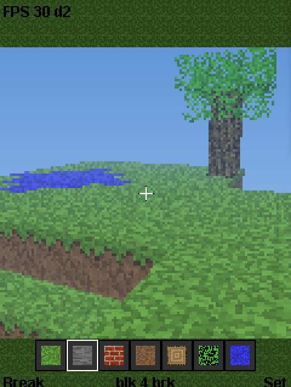
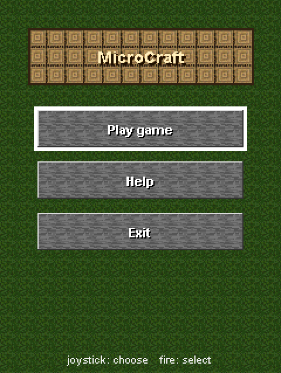
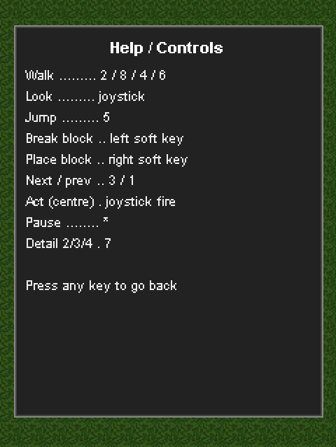
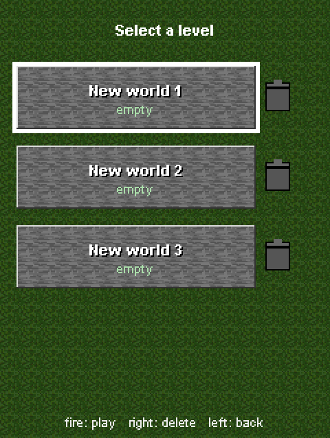
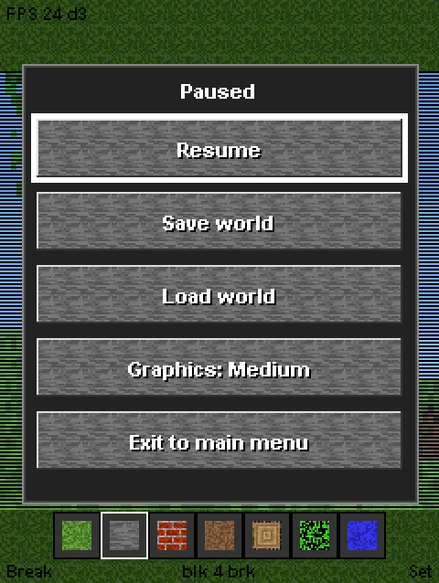
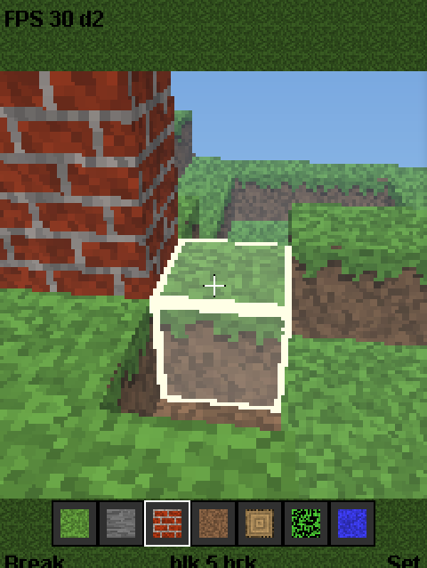

# MicroCraft4K

A **MicroCraft4K** port of the modded **Minecraft4k-JS** version by **Notch** — a
software voxel raycaster running on plain J2ME/CLDC hardware. It is optimized for
**240×320 Sony Ericsson K800** and **Aino U10i** handsets (tested on the real
devices), and delivers good overall performance with no 3D hardware and no external
assets: every texture, the terrain, the player and the sky are generated in code.



## About

MicroCraft4K is a faithful J2ME port of the JavaScript "enhanced" Minecraft4k
(`4k.js`), itself a restore of Notch's famous 4 KB Minecraft. The original renders a
64³ block world with a per-pixel ray caster into a 2D pixel buffer; this port keeps
that idea and rebuilds the engine around a fixed-point (16.16) DDA so it can run at
a playable frame rate on CLDC 1.1 / MIDP 2.0 phones.

Everything is procedurally generated and packed into a single MIDlet (~20 KB JAR)
with no image or model resources.

## Screenshots

| Main menu | Help / controls |
|:---:|:---:|
|  |  |
| **Level select** | **Pause menu** |
|  |  |
| **Targeting a block** | **Another world** |
|  |  |

## Features

- **Software voxel raycaster** — Amanatides & Woo DDA in 16.16 fixed point, no
  floating point and no per-pixel trigonometry in the inner loop.
- **Runtime detail levels** — *Fancy / Medium / Fast* trade internal resolution for
  speed; the live FPS is shown in the top band.
- **Infinite-looking world feel** — distance fog fades terrain into a procedural sky
  gradient; the block haze avoids a hard horizon line.
- **Build & mine** — target highlight, break the aimed block, place the selected
  block against the face you are looking at.
- **Hotbar** — seven block types with real in-game texture previews, switched with
  the keypad.
- **Physics** — gravity, a ~1-block jump and axis-separated collision so you walk on
  the terrain instead of through it.
- **Menu shell** — main menu, help screen and a level-select screen.
- **Save / load** — three level slots persisted in a MIDP `RecordStore` (RMS); a
  fresh slot generates new terrain, a saved slot is restored exactly.
- **Two-screen friendly** — the 240×240 play area is centred with UI bands above and
  below, remaining correct on 240×320 (K800) and 240×432 (U10i).

## Controls

While playing:

| Action | Key |
|---|---|
| Walk | `2` `8` `4` `6` |
| Look (yaw / pitch) | joystick left / right / up / down |
| Jump | `5` |
| Break block | left soft key |
| Place block | right soft key |
| Next / previous block | `3` / `1` |
| Act (centre) | joystick fire |
| Detail (Fancy / Medium / Fast) | `7` |
| Pause / resume | `*` |

In menus, use the joystick to choose and **fire** to select. In the level list,
joystick-right focuses the trash icon to delete a slot, and the left soft key goes
back.

## Getting started

### Requirements

- **Sun Java Wireless Toolkit 2.5.2** (`WTK2.5.2_01`).
- **JDK 8** (`jdk1.8.0_131` recommended — the WTK compiler/preverifier target
  `-source 1.4 -target 1.4`, class file version 48).

### Build

The build script compiles against the CLDC 1.1 / MIDP 2.0 bootclasspath, runs the
WTK preverifier and packages `bin/Minecraft4k.jar` + `bin/Minecraft4k.jad`:

```powershell
powershell -ExecutionPolicy Bypass -File build.ps1
```

Paths to the JDK and WTK are set at the top of `build.ps1`. Options:

```powershell
powershell -ExecutionPolicy Bypass -File build.ps1 -Run                 # build then launch the emulator
powershell -ExecutionPolicy Bypass -File build.ps1 -Device U10i         # pick an emulator device
```

### Run

Launch on the emulator:

```powershell
"<WTK>\bin\emulator.exe" -Xdevice:K800 -Xdescriptor:bin\Minecraft4k.jad
```

For a real handset, transfer `bin/Minecraft4k.jar` and `bin/Minecraft4k.jad` (or the
JAR alone) to the device and install it as a normal MIDlet. The game is designed for
and has been run on a **Sony Ericsson K800** and **Aino U10i**.

## How it works

- The visual area is a fixed **240×240** square, rendered internally at a lower
  resolution (`scale` = 2/3/4, one memory pixel per `scale`×`scale` screen block)
  and block-expanded into the screen with `drawRGB`. The ray count per frame is
  therefore independent of the phone's screen height.
- The **voxel map** (15³ blocks) is stored padded with a one-cell sentinel shell so
  the raycaster needs no per-step bounds test — a ray that leaves the world simply
  hits the sentinel and stops.
- **Per-pixel costs a handful of integer adds**: ray directions come from
  precomputed per-column/per-row tables; shading is a table lookup (`SHADE`) and fog
  is a bit-shift (`VIEW8`).
- Terrain, textures and the crosshair highlight are all generated from a seeded
  `Random`, so a level slot is fully reproducible from its seed.

## Project layout

```
build.ps1                 build + package + optional run
project.properties        WTK project properties
src/
  Minecraft4k.java        MIDlet entry point
  GameCanvas.java         engine, renderer, menus, RMS save/load
res/
  Minecraft4k.png         MIDlet icon
src-original/
  4k.js / 4k.html         JavaScript reference (the port's source of truth)
  DESCRIPTION.md          detailed description of the JS engine
screenshots/              emulator screenshots used in this README
```

## Credits

- **Markus "Notch" Persson** — original *Minecraft4k*.
- The **Minecraft4k-JS ("ChamberedTest") enhanced port** — the JavaScript engine this
  J2ME port is based on (`src-original/`).
